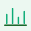
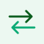
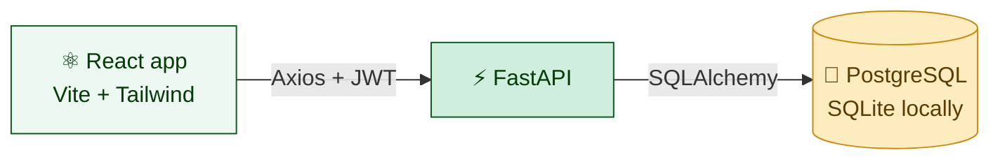

<div align="center">


<br/>


### [▶ Try the live demo](https://cashwell-finance.vercel.app) &nbsp;·&nbsp; [📘 Setup guide](SETUP.md) &nbsp;·&nbsp; [✨ Features](#-features) &nbsp;·&nbsp; [🚀 Quick start](#-quick-start)

[](https://cashwell-finance.vercel.app)

</div>

Log income and expenses, set a monthly budget for each category, and watch a live dashboard update as you go.

> [!NOTE]
> CashWell is a full-stack portfolio project, built to learn how the whole stack fits together.

> [!TIP]
> Just want a look? Open the [live demo](https://cashwell-finance.vercel.app) and press **Try the demo**. One click, no sign-up, six months of sample data.

> [!CAUTION]
> The demo account is shared by everyone who opens it. Please don't enter real financial details.

---

## ✨ Features

<table>
  <tr>
    <td width="33%" valign="top">
      <br/>
      <b>Transactions</b><br/>
      Add, edit and delete them, with paging controls to jump to the first or last page.
    </td>
    <td width="33%" valign="top">
      <br/>
      <b>Smart note search</b><br/>
      Suggestions appear as you type, and a misspelled word gets a <i>"Did you mean…?"</i> fix. Nothing changes in the table until you press Enter.
    </td>
    <td width="33%" valign="top">
      <br/>
      <b>Filter and export</b><br/>
      Filter by type, category and date range, then download the result as CSV.
    </td>
  </tr>
  <tr>
    <td valign="top">
      <br/>
      <b>Budgets</b><br/>
      A monthly limit per category, with progress bars that go from green to amber to red.
    </td>
    <td valign="top">
      <br/>
      <b>Dashboard</b><br/>
      Balance, income, expenses and savings rate for any month, plus a six-month chart and a spending donut.
    </td>
    <td valign="top">
      <br/>
      <b>Motion</b><br/>
      Animated counters, springy modals, and hand-drawn SVG scenes: a tipping coin jar, a calculator-tapping glove and a steaming coffee cup.
    </td>
  </tr>
  <tr>
    <td valign="top">
      <br/>
      <b>Responsive</b><br/>
      A bottom tab bar in the app and a hamburger menu on the public pages.
    </td>
    <td valign="top">
      <br/>
      <b>Private by design</b><br/>
      JWT sessions, bcrypt passwords, and every query scoped to the logged-in user.
    </td>
    <td></td>
  </tr>
</table>

## 📸 Screenshots

<details open>
<summary><b>Dashboard and Budgets</b></summary>
<br/>

| Dashboard | Budgets |
|---|---|
|  |  |

</details>

<details>
<summary><b>Transactions and Login</b></summary>
<br/>

| Transactions | Login |
|---|---|
|  |  |

</details>

## 🚀 Quick start

```bash
git clone https://github.com/RebEmnacin/CashWell.git
```

<details open>
<summary><b>Terminal 1: backend</b> (Python 3.10+)</summary>

```bash
cd CashWell/backend
python -m venv venv
source venv/bin/activate        # Windows: venv\Scripts\activate
pip install -r requirements.txt
cp .env.example .env
uvicorn app.main:app --reload
```

</details>

<details open>
<summary><b>Terminal 2: frontend</b> (Node 20.19+ or 22.12+)</summary>

```bash
cd CashWell/frontend
npm install
npm run dev
```

</details>

Open http://localhost:5173 and press **Try the demo**.

> [!IMPORTANT]
> The backend won't start without a `SECRET_KEY`. The example `.env` has a placeholder that is fine locally. Use a real one anywhere public. Everything else, including Postgres and deployment, is in the **[setup guide](SETUP.md)**.

## 🧩 How it works



The frontend and the API are separate apps, both deployed on Vercel, with Neon Postgres behind the API. Interactive API docs are served at `/docs` on a running backend.

<details>
<summary><b>🛠 Tech stack, and why</b></summary>
<br/>

| Layer | Choice | Why |
|---|---|---|
| UI | React 19 + TypeScript | Typed components catch mistakes before the browser does |
| Build | Vite | Instant dev server and fast builds |
| Styling | Tailwind CSS v4 | Design tokens (the green and amber theme) live in one place |
| Motion | `motion`, React Spring | Springy modals and animated counters |
| State | Zustand | A tiny store for the login session |
| Charts | Recharts | Bar chart and donut with little code |
| API | FastAPI | Typed request and response models, and free interactive docs |
| Database | PostgreSQL (Neon) | Real aggregation in SQL, with SQLite for easy local runs |

</details>

<details>
<summary><b>🔌 API at a glance</b></summary>
<br/>

| Area | Endpoints |
|---|---|
| Auth | `POST /auth/register` · `POST /auth/login` · `POST /auth/demo` · `GET/PATCH /auth/me` |
| Transactions | `GET /transactions` (search, filters, paging) · `GET /transactions/export` · `POST` · `PUT /{id}` · `DELETE /{id}` |
| Categories | `GET` · `POST` · `DELETE /{id}` |
| Budgets | `GET` · `PUT /{category_id}` · `DELETE /{category_id}` |
| Analytics | `GET /analytics/summary` · `/by-category` · `/monthly` |

</details>

<details>
<summary><b>📁 Project layout</b></summary>

```
CashWell/
├── backend/app/
│   ├── routers/        auth, transactions, categories, budgets, analytics
│   ├── models.py       SQLAlchemy tables
│   ├── schemas.py      Pydantic request and response shapes
│   └── security.py     JWT and bcrypt
├── frontend/src/
│   ├── pages/          Landing, Login, Dashboard, Transactions, Budgets, Account
│   ├── components/     NoteSearch, TransactionModal, JarCoins, HandCalculator...
│   └── lib/            autocorrect
├── docs/               banner, icons and screenshots used by this README
└── SETUP.md            Postgres and deployment
```

</details>

## 🧠 Engineering decisions

1. **Data isolation.** Every query filters by `user_id`, and category ownership is re-checked on every write.
2. **The server decides the type.** Income or expense comes from the category on the server, never from the client.
3. **Aggregation in SQL.** Totals and the six-month chart use `GROUP BY` and `SUM`, with empty months filled in.
4. **Date-range correctness.** Month queries use an exclusive end date, so no day is missed or counted twice.
5. **Debounced search.** Suggestions wait 200 ms after typing stops instead of calling the API on every keystroke, and a stale request is cancelled when a newer one starts.
6. **Autocorrect from your own words.** It only suggests words that already appear in your notes, so a correction always leads to results and never invents a word.

<div align="center">

<br/>


**Built by [RebEmnacin](https://github.com/RebEmnacin)** · If CashWell helped you, a ⭐ is appreciated

</div>
